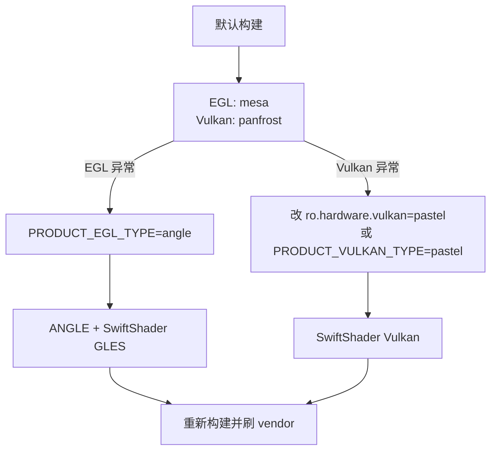

# 验收记录

记录 `orangepi-3b-gpu-bringup` 的上机结果。本机路径、commit 与产物哈希按约定不写在这里，构建来源信息见 `vendor/6xyun/hardware/gpu/mesa/` 的 `build-info.txt` 与 `SHA256SUMS`。

## 环境

| 项 | 值 |
| --- | --- |
| 平台 | RK3566（Cortex-A55 ×4），GPU 为 Mali-G52 r1 MC1 |
| 内核 | 6.18 主线 Panfrost + `gpu-sched`，runtime PM 与 devfreq 正常 |
| 用户态 | 出树构建的 Mesa GLES（Panfrost）与 PanVK，minigbm gralloc0 |
| 显示 | HDMI + MIPI DSI 双屏（细节见 `orangepi-3b-display-bringup`） |
| SELinux | `permissive`，相关 `same_process_hal_file` 标签已就位，未做 enforcing 验证 |

## 分项结果

| 任务 | 验收内容 | 结果与证据 |
| --- | --- | --- |
| 2.7 | 界面 GPU 渲染 | `dumpsys SurfaceFlinger` 报 `GLES: Mesa, Mali-G52 r1 MC1 (Panfrost), OpenGL ES 3.1`；桌面合成、滑动与视频窗口正常，未回落到 SwiftShader |
| 2.8 | GLES 版本与 AEP | `getprop ro.opengles.version` 为 `196609`（3.1）；`android.hardware.opengles.aep.xml` 随 vendor 安装并生效 |
| 2.9 | 缓冲互操作 | Mesa 日志为 `Using gralloc0 CrOS API`；`gl2_yuvtex` 通过（YV12 导入 Panfrost）；Gallery 播放 NV12 视频 46 帧，无 EGL/gralloc 错误 |
| 2.10 | 挂起恢复 | `echo mem` 休眠后用预设定时唤醒，恢复后无 `panfrost_job_timedout` 的 synchronous external abort，GPU 电源域重新上电 |
| 2.11 | EGL 回退 | 以 `PRODUCT_EGL_TYPE=angle` 构建并刷 vendor，系统正常启动、显示正常；随后恢复默认 `mesa` |
| 2.12 | Vulkan 后端 | `cmd gpu vkjson` 枚举到 `Mali-G52 r1 MC1`；`/vendor/bin/panvk_smoke` 输出 `RESULT: PASS`，红/绿/混合三色（含 0.25/0.5/0.75）逐通道与期望一致；`apiVersion` 1.0.346、`driverVersion` 26.0.99；`ro.hardware.vulkan=panfrost` 且 Bifrost 使能属性为 `1` |
| 2.13 | 异常隔离 | 视频播放中 `am force-stop com.android.gallery3d` 中断会话，`dmesg` 无 oops，`surfaceflinger`/`system_server`/`zygote` 保持稳定，`gl2_yuvtex` 仍能进入渲染循环（返回 124） |

补充：Launcher 崩溃由缺失 `android.software.app_widgets` 特性导致，补上 `android.software.app_widgets.xml` 后 `OSEManager` 崩溃计数归零。

## 关于 Vulkan 的两点限制

- PanVK 在 Bifrost（arch 7）上需要 `PAN_I_WANT_A_BROKEN_VULKAN_DRIVER` 才会枚举出物理设备，产品始终通过属性 `debug.mesa.pan.i.want.a.broken.vulkan.driver=1` 注入（对 `pastel` 不生效）；
- PanVK 在该 GPU 上只报 Vulkan 1.0，而 HWUI 的 Vulkan 路径要求物理设备 `apiVersion >= 1.1`（`VulkanManager` 中为 `LOG_ALWAYS_FATAL_IF`），因此 `debug.hwui.renderer=skiavk` 会 abort 应用进程，Vulkan 验收只覆盖 Vulkan 1.0 用例，界面仍走 GLES。

## 回退矩阵

| 回退项 | 命令 | 状态 |
| --- | --- | --- |
| EGL → ANGLE | `m vendorimage PRODUCT_EGL_TYPE=angle` | 已验证（2.11），启动与显示正常 |
| Vulkan → pastel | 设备上把 `ro.hardware.vulkan` 改为 `pastel` 后重启（两个 `.so` 都在镜像内），或 `m vendorimage PRODUCT_VULKAN_TYPE=pastel` | 命令与预期已记录，该分支未单独上机；默认 `panfrost` 分支已验证 |
| GPU 内核驱动 | 无需回退，模块随镜像常驻 | — |

`ro.hardware.egl` / `ro.hardware.vulkan` 都是只读属性，两条回退都需要重新构建并刷写 vendor，不能运行期 `setprop` 切换。
